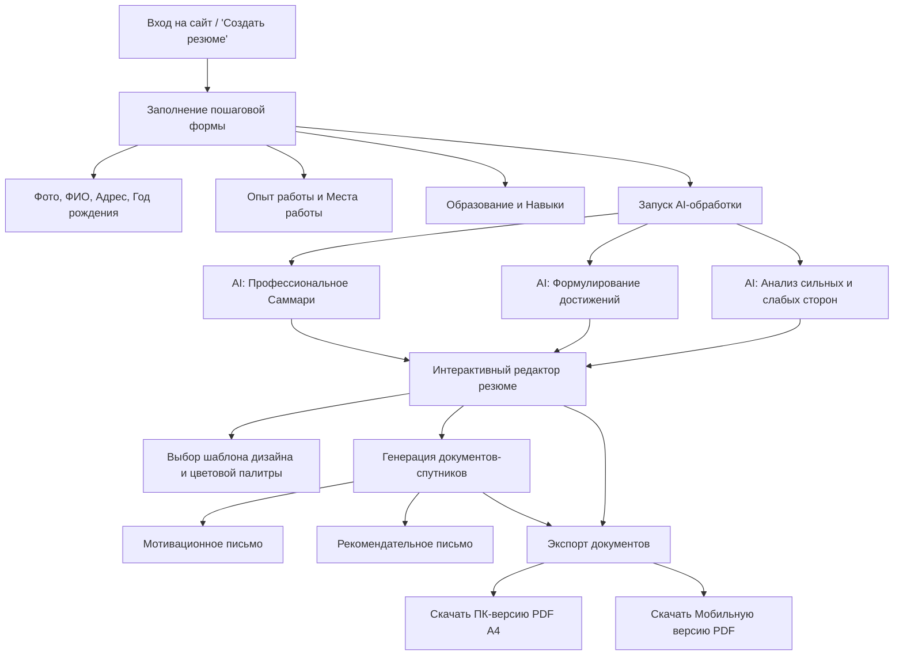
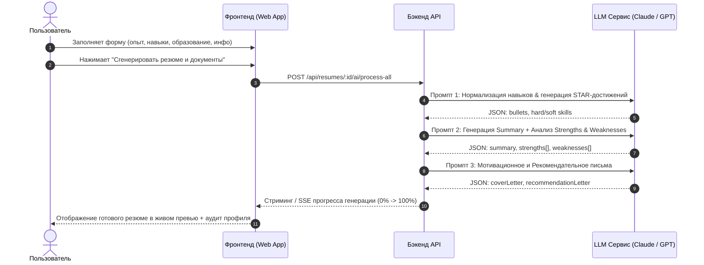

# PRD: Конструктор резюме с ИИ (CV Builder AI)

| Поле | Значение |
|---|---|
| **Продукт** | Конструктор резюме нового поколения с ИИ-ассистентом (**CV Builder AI**) |
| **Версия документа** | 2.0 |
| **Дата** | 17.11.2026 |
| **Статус** | Согласовано к разработке |
| **Стек проекта** | React (Next.js / Vite), TypeScript, Tailwind CSS, Node.js, Puppeteer, Claude / OpenAI API |

---

## 1. Введение и обзор продукта

### 1.1. Проблематика
1. **Сложность самопрезентации**: Более 75% соискателей испытывают трудности с описанием своего опыта: пишут шаблонные должностные обязанности вместо измеримых результатов и достижений, не умеют подчеркнуть свои конкурентные преимущества.
2. **Слепые зоны и слабые стороны**: Кандидаты не видят пробелов в своём профиле (gap в опыте, нехватка ключевых навыков, несбалансированное резюме) и не знают, как нивелировать слабые стороны.
3. **Нечитаемость на смартфонах**: До 65% первичных скринингов рекрутеры проводят со смартфонов (в Telegram, почте, мессенджерах). Обычные файлы формата A4 при открытии на телефоне требуют постоянного зума и горизонтального скролла, что снижает конверсию в приглашение на интервью.
4. **Необходимость комплекта документов**: Для качественного отклика одного резюме недостаточно — требуются мотивационное письмо (Cover Letter) под вакансию и рекомендательное письмо (Recommendation Letter), на составление которых уходят часы.
5. **Вёрстка и дизайн**: Создание визуально привлекательного резюме в Word/Canva требует больших временных затрат, а результат часто ломает верстку при экспорте или не парсится ATS (Applicant Tracking Systems).

### 1.2. Решение
Интеллектуальный веб-сервис **CV Builder AI**, позволяющий за 7–10 минут сформировать профессиональный карьерный пакет:
- **Удобная форма сбора данных**: фото, Ф.И.О., контакты, адрес, год рождения, опыт, места работы, образование, навыки.
- **AI-ассистент полного цикла**:
  - Автоматически формулирует мощное саммари («О себе» / Summary).
  - Преобразует черновой опыт в сильные формулировки с достижениями (STAR-методология).
  - Проводит аудит резюме: **подчеркивает сильные стороны** и **выявляет слабые стороны** (с рекомендациями по улучшению).
  - Генерирует **мотивационное письмо** и **рекомендательное письмо** на основе данных резюме.
- **Гибкая дизайн-система**: выбор из 5+ адаптивных шаблонов и палитр цветовых тем с мгновенным переключением без потери данных.
- **Двухформатный экспорт в PDF**:
  - **Версия для ПК (A4 PDF)**: идеально для печати, отправки по email и ATS-систем.
  - **Мобильная версия (Mobile PDF / Single Column)**: адаптирована под вертикальный экран смартфона для мгновенного и комфортного чтения рекрутером.

### 1.3. Ключевые бизнес-метрики (KPIs)
| Метрика | Описание | Целевой показатель (3 мес.) |
|---|---|---|
| **Time-to-CV** | Медианное время от захода на сайт до скачивания готового резюме | ≤ 8 минут |
| **AI Satisfaction Rate** | Процент пользователей, принявших формулировки ИИ без существенных правок | ≥ 70% |
| **Kit Generation Rate** | Доля пользователей, сгенерировавших мотивационное или рекомендательное письмо | ≥ 40% |
| **Completion Rate** | Конверсия из первого заполненного поля формы в скачивание PDF | ≥ 50% |
| **Mobile Export Share** | Доля скачиваний мобильной версии PDF от общего числа экспортов | ≥ 35% |

---

## 2. Пользовательские персоны и сценарии

### 2.1. Персоны
1. **Джуниор / Студент (0–1 год опыта)**:
   - *Проблема*: Мало коммерческого опыта, страх «пустого резюме».
   - *Решение*: ИИ помогает раскрыть учебные и пет-проекты, подсвечивает сильные стороны (быстрая обучаемость, свежий стек) и помогает компенсировать нехватку стажа в мотивационном письме.
2. **Опытный специалист / Мидл / Сеньор (3–8 лет опыта)**:
   - *Проблема*: Огромный массив разрозненных задач, резюме перегружено рутиной.
   - *Решение*: ИИ структурирует опыт, переводит обязанности в бизнес-результаты и метрики, убирает «воду».
3. **Карьерный свитчер (смена профессии)**:
   - *Проблема*: Опыт работы в одной сфере, а поиск работы — в другой.
   - *Решение*: ИИ анализирует переносимые навыки (transferable skills), генерирует убедительное мотивационное письмо, объясняющее переход.

### 2.2. Пользовательский сценарий (User Journey)


---

## 3. Детальные функциональные требования

### 3.1. Модуль формы ввода данных

#### FR-1. Фотография кандидата
- **Форматы**: JPG, PNG, WEBP (до 10 МБ).
- **Инструменты обработки**: встроенный интерактивный кроппер (кадрирование в круг/квадрат), масштабирование (zoom), поворот на 90°.
- **Опциональность**: загрузка фото не является блокирующей. Шаблоны автоматически адаптируют компоновку при отсутствии фотографии.
- **Хранение**: оптимизация и конвертация на стороне сервера в WebP (600×600 px).

#### FR-2. Персональные данные и локация
| Поле | Тип | Обязательность | Валидация / Описание |
|---|---|---|---|
| **Ф.И.О.** | text | Да | 2–100 символов, авто-капитализация первых букв |
| **Желаемая должность / Роль** | text | Да | 2–100 символов, умные автоподсказки популярных профессий |
| **Год рождения** | number / date | Да | Диапазон: от 1940 до (текущий год - 14). Опция «Показывать возраст (число лет)» или «Показывать дату/год» |
| **Переключатель скрытия возраста** | toggle | Нет | Возможность скрыть возраст в итоговом документе (для международных рынков) |
| **Адрес (Локация)** | text / group | Да | Город, Страна (опционально: район/метро/готовность к релокации и удаленной работе) |

#### FR-3. Контакты
- **Телефон**: маска ввода с автоопределением кода страны (по умолчанию локальный регион: +998 / +7 и др.).
- **Email**: проверка синтаксиса RFC 5322.
- **Мессенджеры и соцсети**: Telegram (@username), LinkedIn, GitHub/Портфолио, персональный сайт.

#### FR-4. Места работы и опыт
Повторяемый блок с возможностью добавления, удаления и изменения порядка (drag-and-drop):
- **Название компании**: текстовое поле (с автоподсказками индустрии).
- **Должность**: текстовое поле.
- **Период работы**: месяц/год начала — месяц/год окончания (чекбокс «Работаю по настоящее время»).
- **Свободное описание обязанностей и задач**: текстовая область (до 2000 символов), куда пользователь может вставить даже черновые заметки, тезисы или неструктурированный текст — база для работы ИИ.
- **Чекбокс «Нет коммерческого опыта»**: активирует режим для студентов (акцент на учебные проекты, фриланс, стажировки).

#### FR-5. Образование
Повторяемый блок:
- **Учебное заведение**: название института/университета/колледжа.
- **Специальность / факультет**: направление подготовки.
- **Уровень образования**: Выпадающий список (Среднее, Среднее специальное, Неоконченное высшее, Бакалавриат, Магистратура, Аспирантура/PhD, Курсы/Сертификаты).
- **Год окончания**: 4-значное число (или «по настоящее время»).

#### FR-6. Навыки (Skills)
- Ввод навыков тегами с автодополнением (библиотека из 2000+ IT, бизнес и гуманитарных навыков).
- Автоматическое разделение на:
  - **Hard skills** (технические инструменты, языки программирования, софт).
  - **Soft skills** (коммуникация, лидерство, тайм-менеджмент).
  - **Языки** (с указанием уровня владения: A1–C2 / Родной).
- Возможность указания уровня владения (1–5 звезд / ползунок) для графических шаблонов.

#### FR-7. Сохранение данных
- Непрерывное автосохранение черновика в `localStorage` (debounce 1.5 сек).
- Облачная синхронизация для авторизованных пользователей через PostgreSQL.

---

### 3.2. Модуль искусственного интеллекта (AI Engine)

#### FR-8. Автоматическая формулировка описания (Summary / О себе)
- ИИ анализирует всю анкету (опыт, навыки, образование, должность) и формирует связное профессиональное саммари.
- Длина: 3–5 емких предложений (400–600 знаков).
- Доступные тональности (Tones):
  - *Деловой / Корпоративный* (строгий, фактологический);
  - *Уверенный / Достигаторский* (акцент на лидерстве и ROI);
  - *Креативный / Стартап* (живой, вовлекающий стиль).

#### FR-9. Сборка и структурирование опыта работы
- ИИ преобразует «сырые» заметки соискателя в маркированный список из 3–5 пунктов на каждое место работы.
- Структурирование по формуле Google X-Y-Z / STAR: *«Достиг [X], измеряемого с помощью [Y], совершив действие [Z]»*.
- **Защита от галлюцинаций**: строгий системный запрет на генерацию несуществующих метрик и мест работы. Если соискатель не указал цифры, ИИ формулирует качественные результаты без выдуманных данных.

#### FR-10. Анализ сильных и слабых сторон соискателя
ИИ запускает диагностический модуль резюме и выдает структурированный отчет:
1. **Сильные стороны (Strengths)**:
   - Выделение 3–5 ключевых конкурентных преимуществ соискателя (например: *«Редкая комбинация компетенций в React и Go»*, *«Подтвержденный опыт масштабирования систем с 10k до 500k DAU»*).
   - Интеграция сильных сторон в блок «Ключевые компетенции» в резюме.
2. **Слабые стороны и точки роста (Weaknesses & Growth Gaps)**:
   - Анализ пробелов: отсутствие подтвержденных результатов в конкретные периоды, нехватка актуальных инструментов для целевой должности, размытые формулировки.
   - **Интерактивные рекомендации**: ИИ дает соискателю подсказки, как усилить слабые места (например: *«В опыте работы в компании X не указан стек — рекомендуем добавить технологии Y и Z»*, *«Большой перерыв между 2023 и 2024 гг. — укажите фриланс или обучение»*).
   - Опция: компенсация слабых сторон в резюме за счет правильной переформулировки фокуса на сильные стороны.

---

### 3.3. Модуль сопроводительных документов (Cover & Recommendation Letters)

#### FR-11. Генератор мотивационного письма (Cover Letter)
- На основе профиля соискателя и (опционально) описания целевой компании / текста вакансии ИИ формирует полноценное мотивационное письмо.
- **Структура письма**:
  1. *Приветствие и персонализация* (к рекрутеру/нанимающему менеджеру).
  2. *Крючок (Hook)*: почему кандидат заинтересован именно в этой роли.
  3. *Соответствие (Fit & Evidence)*: 2–3 главных достижения из опыта кандидата, решающие боли компании.
  4. *Культурное соответствие (Soft skills & Values)*: почему с кандидатом комфортно работать.
  5. *Призыв к действию (Call-to-Action)*: готовность к интервью и контакты.
- Возможность редактирования сгенерированного письма в богатом текстовом редакторе.

#### FR-12. Генератор рекомендательного письма (Recommendation Letter)
- Часто работодатели просят соискателя «написать рыбу рекомендации, а руководитель подпишет».
- ИИ генерирует официальное рекомендательное письмо от лица бывшего руководителя / тимлида / преподавателя на основе указанных в резюме проектов.
- **Параметры генерации**:
  - Выбор автора рекомендации: Непосредственный руководитель / Технический директор / Коллега / Ментор.
  - Подтверждение ключевых обязанностей и личных качеств соискателя.
  - Фирменная шапка с полями для подписи и контактов рекомендателя.

---

### 3.4. Модуль дизайна и кастомизации

#### FR-13. Набор шаблонов дизайна
В систему закладывается минимум **5 адаптивных шаблонов**:
1. **Modern (Современный)**: Сбалансированная двухколоночная верстка, цветная боковая панель с контактами и навыками, круглый аватар.
2. **Classic (Классический)**: Одноколоночный строгий дизайн, серифные элегантные шрифты, акцент на хронологию опыта. Идеально для корпоративного и финансового сектора.
3. **Minimal (Минималистичный)**: Максимум свободного пространства, акцентная типографика без лишних декоративных линий.
4. **Creative (Креативный)**: Брендированная шапка, стильные бейджи навыков, акцентная инфографика.
5. **ATS Executive**: Строго структурированный одноколоночный формат, оптимизированный под 100% распознавание парсерами ATS без графических артефактов.

#### FR-14. Цветовые палитры и темы
- **8 готовых дизайнерских тем**:
  1. *Ocean Navy* (Глубокий сапфировый + стальной серый)
  2. *Emerald Green* (Изумрудный благородный + мятный акцент)
  3. *Slate Graphite* (Темный графит + нейтральный белый)
  4. *Burgundy Wine* (Глубокий винный + теплый песочный)
  5. *Tech Indigo* (Нео-индиго + лавандовый)
  6. *Nordic Sky* (Скандинавский лазурный + ледяной)
  7. *Terracotta Sunset* (Теплая терракота + кремовый)
  8. *Monochrome Pro* (Черно-белый контраст высокой четкости)
- **Кастомная палитра**: Color picker с динамическим расчетом вспомогательных оттенков (50, 100, 500, 700) и автоматической валидацией контрастности текста по **WCAG 2.1 AA** (коэффициент не менее 4.5:1).
- Мгновенное переключение тем на лету через CSS Custom Properties без мерцания и перезагрузки.

---

### 3.5. Модуль экспорта в PDF

#### FR-15. Версия для ПК (Desktop Print PDF)
- **Формат**: Стандартный лист **A4 (210 × 297 мм)**.
- **Особенности**:
  - Высокоточный рендеринг через headless Chromium (Puppeteer) пиксель-в-пиксель.
  - Полноценный выделяемый векторный текст (поддержка копирования и ATS-парсинга).
  - Активные гиперссылки (почта, телефон, соцсети).
  - Защита от разрыва логических блоков (`break-inside: avoid` для мест работы и учебы).
  - Многостраничный режим (автоматический перенос на 2-ю страницу при превышении объема).

#### FR-16. Мобильная версия (Mobile-optimized PDF)
- **Формат**: Одностраничный вертикальный скролл-документ (Single continuous mobile page) с шириной **390–414 px** (эквивалент экрана современных iPhone / Android) и динамической высотой.
- **Особенности**:
  - Полное отсутствие горизонтального скролла и микроскопического шрифта на смартфонах.
  - Размер основного текста не менее 14–16 pt для идеальной читаемости с расстояния вытянутой руки.
  - Крупные кликабельные кнопки быстрых действий: *«Позвонить»* (`tel:`), *«Написать в Telegram»* (`t.me/`), *«Email»* (`mailto:`).
  - Преобразование двух колонок в одну последовательную вертикальную цепочку.
  - Возможность экспорта как в **Mobile PDF**, так и в высококачественный **Mobile PNG** (1080 px по ширине) для прямой отправки в мессенджеры в виде картинки.

#### FR-17. Экспорт сопроводительных документов
- Скачивание комплекта:
  - Резюме (ПК / Мобильная версия).
  - Мотивационное письмо (формат A4 в едином стиле с резюме).
  - Рекомендательное письмо (формат A4 с фирменным оформлением).
- Опция «Скачать все одним ZIP-архивом».

---

## 4. Архитектура системы и модель данных

### 4.1. Модель данных TypeScript (`ResumeSchema`)

```typescript
export interface ResumeData {
  id: string;
  userId?: string;
  createdAt: string;
  updatedAt: string;
  language: 'ru' | 'en' | 'uz';

  // Личные данные
  personal: {
    fullName: string;
    targetPosition: string;
    birthYear: number;
    showAge: boolean;
    hideBirthDate: boolean;
    photoUrl?: string;
    photoCrop?: { x: number; y: number; zoom: number };
    address: {
      country: string;
      city: string;
      districtOrStreet?: string;
      willingToRelocate?: boolean;
      remoteWork?: boolean;
    };
  };

  // Контакты
  contacts: {
    phone: string;
    email: string;
    telegram?: string;
    linkedin?: string;
    githubOrPortfolio?: string;
    website?: string;
  };

  // Опыт работы
  experience: Array<{
    id: string;
    company: string;
    role: string;
    location?: string;
    startDate: string; // YYYY-MM
    endDate: string | null; // null = по настоящее время
    isCurrent: boolean;
    rawDescription: string;
    aiProcessedBullets: string[];
    keyAchievements?: string[];
  }>;

  // Образование
  education: Array<{
    id: string;
    institution: string;
    facultyOrSpecialty: string;
    degreeLevel: 'school' | 'college' | 'bachelor' | 'master' | 'phd' | 'course';
    graduationYear: number;
  }>;

  // Навыки
  skills: {
    hard: Array<{ name: string; level?: number }>;
    soft: string[];
    languages: Array<{ name: string; level: 'A1' | 'A2' | 'B1' | 'B2' | 'C1' | 'C2' | 'Native' }>;
  };

  // Блок искусственного интеллекта
  aiAnalysis: {
    summary: string;
    strengths: Array<{
      title: string;
      description: string;
      matchedExperienceId?: string;
    }>;
    weaknesses: Array<{
      area: string;
      description: string;
      recommendation: string;
    }>;
    tone: 'corporate' | 'confident' | 'creative';
    completenessScore: number; // 0 - 100%
  };

  // Сопроводительные документы
  attachedDocuments: {
    coverLetter?: {
      targetCompany?: string;
      targetVacancy?: string;
      content: string;
      updatedAt: string;
    };
    recommendationLetter?: {
      recommenderName: string;
      recommenderRole: string;
      company: string;
      relationship: string;
      content: string;
      updatedAt: string;
    };
  };

  // Стилизация и оформление
  design: {
    templateId: 'modern' | 'classic' | 'minimal' | 'creative' | 'ats';
    themeId: string;
    customColor?: string;
    fontFamily: string;
    fontSize: 'compact' | 'normal' | 'spacious';
    sectionOrder: string[];
    hiddenSections: string[];
  };
}
```

### 4.2. Архитектура компонентов монорепозитория
- `apps/web`: Клиентская часть (Next.js / Vite + React, Tailwind CSS, Zustand, React-Hook-Form, Lucide Icons, DnD-Kit).
- `apps/api`: Бэкенд-сервис (Node.js, Fastify/Express, Prisma / Drizzle ORM, PostgreSQL).
- `packages/templates`: React-шаблоны резюме, изолированные CSS-стили, единый интерфейс свойств `TemplateProps`.
- `packages/ai-prompts`: Промпты для LLM, схемы Structured Output (Zod / JSON Schema), валидаторы анти-галлюцинаций.
- `packages/shared`: Общие типы TypeScript, утилиты валидации и форматирования.

---

## 5. Алгоритм и пайплайн ИИ-обработки



### 5.1. Правила валидации вывода ИИ
1. **Проверка фактической точности (Fact Checking)**: Все числовые показатели и компании, фигурирующие в сгенерированном тексте, сверяются со входными данными пользователя.
2. **Языковой суверенитет**: Автоматическое определение языка ввода с возможностью перевода на целевой язык резюме (RU / EN / UZ) без стилистических искажений.
3. **Отсутствие токсичных штампов**: Запрет на использование пустых клише (*«стрессоустойчивый командный игрок»*, *«легкообучаемый специалист»*) — замена на факты и результаты.

---

## 6. Требования к UI/UX

### 6.1. Двухоконный интерфейс редактора (Desktop)
- **Левая часть (45% экрана)**:
  - Шаговый мастер ввода данных: Личные данные → Места работы → Образование → Навыки → Настройка документов.
  - Блок подсказок ИИ и виджет оценки резюме (Resume Score).
- **Правая часть (55% экрана)**:
  - Живое превью резюме (Live Preview) с синхронным обновлением при вводе.
  - Верхний тулбар: Переключатель шаблонов, кружки палитр, выбор шрифта.
  - Переключатель отображения: **[🖥 ПК-версия (A4)]** / **[📱 Мобильный вид]**.
  - Вкладки документов: **[Резюме]** / **[Мотивационное письмо]** / **[Рекомендация]**.
  - Кнопка **«Скачать PDF»** с выпадающим меню вариантов.

### 6.2. Мобильный интерфейс конструктора
- Адаптивный интерфейс для работы на самом смартфоне:
  - Нижняя панель навигации (Bottom Bar): *Редактор* / *Превью* / *Дизайн* / *Документы*.
  - Плавающая кнопка быстрого экспорта.

---

## 7. Нефункциональные требования (NFR)

1. **Производительность**:
   - Время формирования PDF-документа на сервере: ≤ 3.5 секунды (p95).
   - Скорость отдачи первого байта при AI-генерации (TTFT): ≤ 1.8 секунды со стримингом.
   - 60 FPS при переключении тем и шрифтов в браузере.
2. **Безопасность и приватность**:
   - Передача всех данных строго по HTTPS (TLS 1.3).
   - Защита персональных данных: шифрование PII (Personally Identifiable Information) в базе данных.
   - Одноразовые подписанные URL на скачивание файлов из S3 с временем жизни 15 минут.
3. **Совместимость с ATS (Applicant Tracking Systems)**:
   - В A4 PDF используется стандартная разметка шрифтов Type 1 / TrueType с поддержкой UTF-8.
   - Тестирование выгрузки в парсерах Textract и Tesseract OCR с точностью распознавания текста ≥ 99%.

---

## 8. Приоритизация требований (MoSCoW)

| Приоритет | Функционал |
|---|---|
| **Must Have (Обязательно к релизу)** | - Полнофункциональная форма: Фото, ФИО, Адрес, Год рождения, Опыт, Места работы, Образование, Навыки.<br>- ИИ-генерация Summary и STAR-достижений.<br>- ИИ-анализ сильных и слабых сторон соискателя.<br>- Генерация Мотивационного письма на базе резюме.<br>- Генерация Рекомендательного письма на базе резюме.<br>- 3 базовых шаблона дизайна (Modern, Classic, ATS).<br>- Смена 8 цветовых палитр.<br>- Экспорт в ПК PDF (A4) и Мобильный PDF (Single-column). |
| **Should Have (Важно)** | - Дополнительные шаблоны (Minimal, Creative).<br>- Кастомный Color Picker с контролем контраста WCAG.<br>- Экспорт мобильной версии в PNG высокого разрешения.<br>- Детальные рекомендации ИИ по устранению слабых сторон. |
| **Could Have (При наличии ресурсов)** | - Импорт существующего резюме из PDF / LinkedIn.<br>- Публичная веб-страница резюме по короткой ссылке.<br>- Адаптация мотивационного письма под URL вакансии. |
| **Won't Have (Вне рамок текущей версии)** | - Прямая интеграция и автоотклик на работных сайтах (HeadHunter, SuperJob).<br>- Видеорезюме.<br>- Нативные мобильные приложения в App Store / Google Play. |

---

## 9. План релизов и этапы разработки

- **Спринт 1 (Форма и база данных)**: Реализация полной формы с полями фото, ФИО, адрес, год рождения, места работы, образование, навыки. Валидация Zod, реактивное превью, сохранение состояния.
- **Спринт 2 (AI Engine & Анализ)**: Интеграция промптов: генерация описания, структурирование опыта, диагностика сильных и слабых сторон соискателя.
- **Спринт 3 (Документы-спутники)**: Разработка генераторов Мотивационного и Рекомендательного писем, UI вкладок дополнительных документов.
- **Спринт 4 (Шаблоны и стили)**: Внедрение каталога шаблонов, переключателя цветовых схем, кастомных шрифтов.
- **Спринт 5 (PDF Rendering Engine)**: Настройка Puppeteer для сборки Desktop A4 PDF и специализированного Mobile PDF. Тестирование переноса страниц и кликабельности.
- **Спринт 6 (QA & Финализация)**: Сквозное тестирование, нагрузочные тесты рендеринга, запуск в промышленную эксплуатацию.

---

## 10. Критерии приемки (Definition of Done)

- [x] Все поля формы (Фото, Ф.И.О., адрес, опыт, навыки, год рождения, места работы, образование) корректно валидируются и отображаются во всех шаблонах.
- [x] ИИ автоматически формулирует связное саммари и структурирует обязанности по каждому месту работы.
- [x] В интерфейсе выводится детальный аудит: список сильных сторон соискателя и подсвеченные слабые стороны с подсказками по исправлению.
- [x] Доступна генерация мотивационного и рекомендательного писем с привязкой к указанному опыту.
- [x] Доступно не менее 5 шаблонов оформления с возможностью смены цветовой палитры в 1 клик.
- [x] При нажатии на «Скачать» формируются два независимых PDF-файла:
  1. **ПК-версия (A4 PDF)** с выделяемым текстом, кликабельными ссылками и корректным постраничным переносом.
  2. **Мобильная версия (Mobile PDF)** в один столбец, оптимизированная под чтение на экранах смартфонов без зума.
